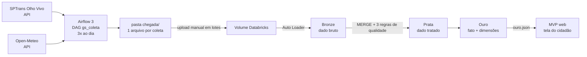

# Ônibus & Chuva SP · CitizenTech

> GS 2026.2 · FIAP · Engenharia de Software 4º ano · Big Data Architecture & Data Integration

## Integrantes

| Nome completo | RM |
|---|---|
| Cássio Eid Kobayashi Yonetsuka | RM99678 |
| Filipe Prado Menezes | RM98765 |
| Gabriel Gomes Catanzaro | RM93445 |
| Henrique Canali Cuzato | RM551326 |
| Lucas Gomes Alcântara | RM98766 |

## Ficha Técnica do MVP

| Campo | Conteúdo |
|---|---|
| Nome do produto | Ônibus & Chuva SP |
| Cidadão e território | Quem depende do ônibus na cidade de São Paulo, incluindo idosos e pessoas com deficiência |
| Problema, em uma frase | O cidadão não sabe se, quando chove, a sua linha terá menos ônibus nas ruas, e perde tempo e segurança esperando |
| Proposta de valor | Mostrar, com dados reais, como a chuva afeta a oferta de cada linha e quantos ônibus acessíveis estão rodando |
| Arquitetura: componentes | Airflow → pasta `chegada/` → Volume Databricks → Bronze → Prata → Ouro → JSON → MVP web |
| Fontes de dados | SPTrans Olho Vivo (API, posição dos ônibus) e Open-Meteo (API, chuva e temperatura por hora) |
| Modelos de IA utilizados | _preencher com as outras disciplinas (IA generativa, visão)_ |
| URL do MVP e repositório | _preencher_ |
| Indicadores de impacto | Variação % da oferta de ônibus com chuva · % de ônibus acessíveis por período · linhas mais sensíveis à chuva |
| ODS conectados | 11 (cidades sustentáveis), 10 (redução das desigualdades), 13 (ação climática), 9 (inovação e infraestrutura) |

## As perguntas que o MVP responde ao cidadão

1. Na minha linha, passam menos ônibus quando chove?
2. Quantos ônibus acessíveis estão rodando agora?
3. Quais linhas mais sofrem com a chuva? (visão para o poder público)

## Arquitetura



O Databricks Free Edition não se conecta ao Airflow, por isso os arquivos da pasta `chegada/` sobem ao Volume pela interface, em lotes.

### Modelo da Ouro

```
dim_linha ──┐
            ├── fato_oferta_linha_hora   (1 linha por linha × hora)
dim_tempo ──┘
posicao_recente   (apoio do MVP, com hash e generalização)
```

## Estrutura do repositório

```
dags/            DAG do Airflow (gs_coleta.py)
databricks/      notebooks: 00 setup, 01 Bronze, 02 Prata, 03 Ouro, 04 consultas SQL, 05 exportação para o MVP
amostras/        um pouco de cada fonte (substituir pelos arquivos reais da 1ª coleta)
mvp/             tela do cidadão (HTML + data/ouro.json)
scripts/         gerador de dados simulados, só para testar antes da coleta real
README.md        este arquivo
```

## Como reproduzir

**1. Airflow 3** (Docker Compose oficial da documentação do Airflow 3)
- Monte `./dags` em `/opt/airflow/dags` e `./chegada` em `/opt/airflow/chegada`.
- Em **Admin > Variables**, crie `SPTRANS_TOKEN` com o seu token da API Olho Vivo. Opcionais: `GS_CHEGADA_DIR` e `ALERTA_WEBHOOK`.
- Ative o DAG `gs_coleta`. Ele coleta às 07h, 12h e 18h (fuso de São Paulo). Deixe rodar em pelo menos 2 dias diferentes.

**2. Databricks Free Edition**
- Rode `databricks/00_setup.sql` e crie as pastas `onibus` e `clima` no Volume `chegada`.
- Envie os arquivos de `chegada/onibus` e `chegada/clima` pelo **Upload to this volume**, em pelo menos 2 lotes de dias diferentes.
- Rode `01_bronze.py` → `02_prata.py` → `03_ouro.py` → `04_consultas.sql`.
- Rode `05_exportar_para_mvp.py`, baixe `ouro.json` e coloque em `mvp/data/ouro.json`.

**3. MVP**
- Local: `cd mvp && python -m http.server 8000` e abra `http://localhost:8000`.
- Público: GitHub Pages apontando para a pasta `mvp/` (ou `/docs`).

## LGPD

- **Não há dados pessoais**: os dados são de frota e clima. Nenhuma localização, nome ou identificador de pessoa é coletado.
- **Minimização na Ouro:** o prefixo do veículo vira hash SHA-256 truncado, as coordenadas são generalizadas (~100 m) e o fato é agregado por linha e hora.
- **Segredos:** token da SPTrans apenas em Airflow Variables. O repositório não contém chaves nem senhas.

## Qualidade e idempotência

- **Bronze:** Auto Loader com checkpoint; o 2º lote lê só os arquivos novos e rodar de novo não duplica.
- **Prata:** `MERGE` pela chave (`prefixo + ts_utc` e `cidade + data_hora`) e 3 regras de qualidade por tabela, com o total barrado gravado em `prata_qualidade`.

## Limitações conhecidas

- A Olho Vivo mostra apenas o "agora", sem histórico: a série cresce com as coletas. Poucos dias de dados deixam o resultado menos confiável, e o MVP avisa isso.
- Se não chover no período de coleta, as consultas de impacto mostram apenas horas "sem chuva".
- Ônibus "na rua" é uma medida de oferta observada, não de atraso: o MVP não afirma que o ônibus atrasou.
